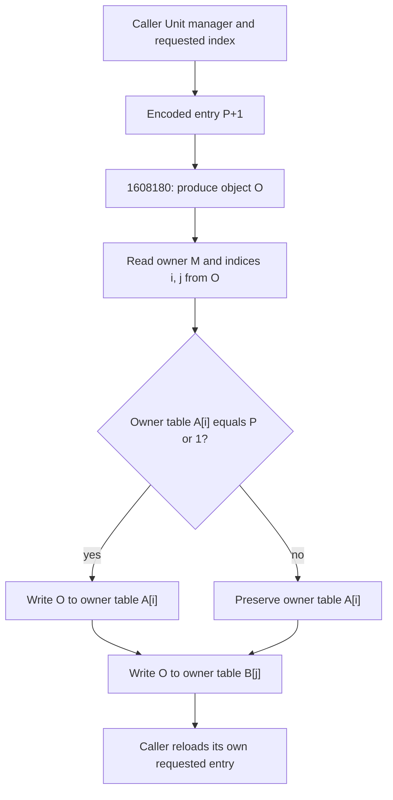

# Catalog context lifetime and lazy entry replacement

The selected lazy resolver `1608180` does not unconditionally replace the
Unit entry requested by its caller. It takes the owner manager and indices
from the produced object, compares that owner's entry with the encoded
input pointer, and conditionally replaces that entry. The caller then
reloads its own requested table and index. Their equality and actual state
remain requirements for closing the catalog acceptance gap.

This checkpoint also expands the previous 15-byte context-publication
window into its complete caller and identifies a later cleanup route.
No populated Unit tables, link-ID assignment, historical rules or successful
replay application are recovered by these static relationships.

## Context publication and cleanup

Complete original `321370..321707` requests F20 bytes for the context.
On successful allocation, `3216C0` calls `31E890`, whose return identity was
qualified in the prior catalog-constructor checkpoint. `3216C5` retains the
result in RBX. The next two stores publish the same pointer to:

| Global RVA | Selected published value |
| --- | --- |
| `3388B18` | context returned by constructor |
| `3388B20` | the same context pointer |
| `3364AF0` | QWORD at context+0 |
| `3364AE8` | QWORD at context+5D8 |
| `3364AD0` | QWORD at context+5E0 |

No additional helper is called after the context constructor in this
function. That closes the former caller-window boundary, under successful
allocation, normal constructor return and stable valid storage. It does not
show that initialization actually ran or that the constructor populated
the logical entry counts. Its allocation-failure path is not treated as
successful usable initialization.

Complete chained function `321FE0..3222FE` reads `3388B20`, writes it back
to active global `3388B18`, and refreshes the three derived aliases. It calls
external `6C4140(0)`, then reloads the active pointer. If nonzero, it calls
`31F720` and `1A24B90(reloaded_pointer,F20)`, followed by a direct zero store
to the active global. The three derived aliases are directly zeroed too.
Those stores precede many further external helper calls: zero globals at
function return and all release-helper effects are not proven. No direct
clear instruction for saved global `3388B20` is identified in this function;
this is not a claim about its callees or all program writes. Equality of
the reloaded pointer with the saved pointer requires `6C4140` to preserve
the active global. This is a static cleanup relationship, not observed
shutdown, a populated-context capture or proof of current live identity.

A targeted transformed-byte scan found two candidates referring to
`3388B20`, and both were qualified as the above instructions. Its scope was
selected seven-byte REX/MOV/LEA RIP-relative forms. It is not an exhaustive
inventory of all possible references or indirect writes. A 48-byte lookahead
heuristic also found 30 Unit-offset candidates; exploratory typed helpers
are not admitted as proof of population or definition-ID assignment.

## Selected caller and lazy wrapper

The previously qualified caller `201A490` reads the Unit manager at active
context+2A0, checks its logical count at +38 and reads the requested entry
from its +48 table. An entry with low bit set causes:

```text
P = encoded_slot - 1
1608180(P, 0)
reload QWORD[caller_manager+48][requested_index]
```

Complete wrapper `1608180..16081DD` retains P in RDI. If its second input is
zero, it calls `1607B10(P)` and saves the result as object O in RBX; a
nonzero second input supplies O directly instead. The selected caller uses
zero. It next calls external helper `27F6D0(P,4,0)`. That helper's full body
and memory effects are not audited in this checkpoint.

The wrapper then obtains these fields from O:

```text
M = QWORD[O+68]
i = WORD[O+2]
j = DWORD[O+8]
A = QWORD[M+48]
B = QWORD[M+78]
T = P | 1

if A[i] == T:
    A[i] = O
B[j] = O
```

The conditional store is a plain compare/branch/store sequence, not an
atomic compare-and-swap. There is no local null/bounds check before these
object/table accesses, so valid object fields and tables are explicit
normal-path conditions. The only direct non-stack stores in the wrapper
are the conditional A[i] store and the B[j] store reached on every normal
return path. It directly writes neither logical count +38 nor +90. This
does not close every external helper's effects on counts or other state.



In the diagram, `P or 1` means the bitwise operation `P | 1`. Owner M/index i
are taken from O; they are not supplied by the caller's requested table
address. To infer replacement of that requested entry, the produced owner,
primary index and table must agree with the retained caller manager/index,
and the expected tagged value must still be present. These actual values
are not captured. No malformed-data or failed-runtime scenario is asserted
from this missing equality proof. The wrapper's return register is not
substituted for the caller's explicit table reload.

## Object producer return identity and open data boundary

Complete `1607B10..160817C` receives P, reads a header from [P] and a base
object from [P+8]. At `1607B57` it calls external `1600BC0(base_object)`.
Its RAX result is saved once in private stack slot RSP+68. Both normal
return definitions return that saved pointer: either directly, or through
R8 loaded from the same slot. The CFG/explicit-register checks qualify this
return identity under stable private-stack and ordinary helper conditions.

The body contains template/bit-mask word-copy paths and additional data
regions. Its entire byte extent and internal branch boundaries are
qualified, but its full expansion memory semantics, external producer
implementation, input payload provenance and resulting object fields are
not. In particular, neither object+68 nor object+2 is assumed to match the
selected Unit request. A normal producer path requires a valid writable
result and valid source payloads; no successful allocation is fabricated.

The practical missing artifact is now precise: the actual encoded entry
and its header/base payload, produced O+68/O+2/O+8, both owner tables, and
the same-context Unit manager count/requested slot. An authenticated merged
catalog and its ID assignment could also supply data. More typed getters
or the static XML path alone cannot provide these values. Historical 41810
input/rules and successful native playback remain separate requirements.

## Validation and preservation

Five complete original RuntimeFunction/CHAININFO unions total 3668 bytes /
993 instructions. Four are new, totaling 3454 bytes / 934 instructions;
the 214-byte Unit-reference caller is inherited and rechecked. All 82
selected instruction/call/RIP checks, five register-flow checks, saved
object return-origin checks and conditional/unconditional store-path
checks pass. Extra objdump seed bytes outside each original union are
excluded. These are bounded static checks, not CPU emulation, a unit-test
suite, actual table capture or native replay application.

The original PE, transformed text and committed prior evidence remain
separate hash-pinned authorities. Original/R8/current replay and unused
launcher-draft bytes are rechecked unchanged. No new replay/sync value,
conversion or production-code change, fresh stream decode, full corpus,
hosted CI or independent peer review is claimed. Existing subagents remain
usage-limited; review was not retried. Native evidence uses Python and
GNU objdump in WSL. No REA target/import, native execution/emulation, game,
Battle.net, Computer Use, external-network request, remote refresh or
publication occurred. Keep all work offline; full upgrade/playback is false.

Addresses, offsets and allocation size F20 are hexadecimal. Counts are decimal.
